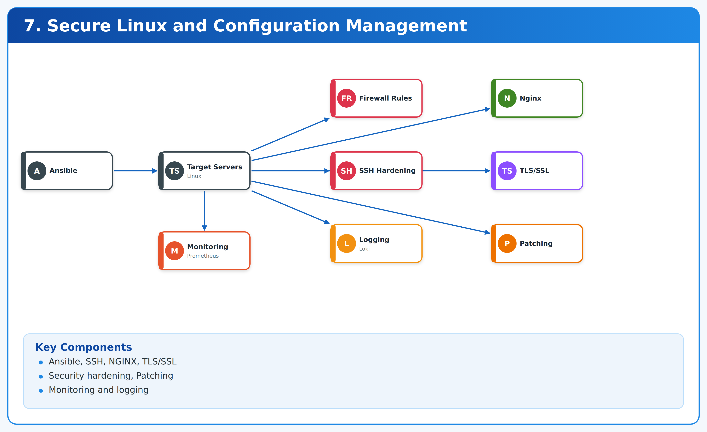
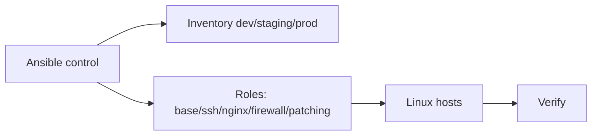

# 07. Secure Linux and Configuration Management



**Ansible · Linux · NGINX** · *Phase 1 — Beginner foundations* · `lab`.

> Harden SSH, auto-patch, NGINX+TLS, UFW firewall. Idempotent roles, check-mode first, verify script. Works on local VM/Docker before any cloud.

## Contents

1. Outcomes 2. Architecture 3. Prerequisites 4. Repo map 5. Step 0 clone 6. Step 1 Ansible install + ping 7. Step 2 check mode 8. Step 3 apply roles 9. Step 4 NGINX+TLS verify 10. Step 5 patching + firewall drill 11. CI 12. Teardown 13. Troubleshooting

## 1. Outcomes

- `PermitRootLogin no`, key-only SSH, fail2ban-ready.
- Unattended upgrades, NGINX reverse proxy + TLS stub, UFW allow 22/80/443 deny rest.
- Repeatable: re-run same playbook = same state.

## 2. Architecture



## 3. Prerequisites

- python3 + pip, ansible (`brew install ansible` / `pip3 install ansible`), ssh, ubuntu target (local VM, Droplet, EC2).
- No cloud for dry-run: uses `localhost` via `infrastructure/inventory.ini`.

## 4. Repository map

```
infrastructure/inventory.ini                  # [lab] localhost local
infrastructure/site.yml                       # hosts lab, roles base/ssh/fw/nginx
infrastructure/roles/ssh_hardening/tasks/main.yml
infrastructure/roles/nginx/tasks/main.yml
tests/smoke.sh | tests/verify.sh (if present)
```

## Step 0 — Clone

```bash
git clone https://github.com/navin-kumar10/secure-linux-config-management.git
cd secure-linux-config-management
bash tests/smoke.sh
cat infrastructure/inventory.ini infrastructure/site.yml
```

## Step 1 — Install and ping

```bash
ansible --version
ansible-inventory -i infrastructure/inventory.ini --list
ansible lab -i infrastructure/inventory.ini -m ping
# expected: localhost | SUCCESS => {"pong": true}
```

## Step 2 — Dry-run (check mode, always first)

```bash
ansible-playbook -i infrastructure/inventory.ini infrastructure/site.yml --check --diff
# READ every change. No firewall lockout surprise: ensure port 22 allowed before enabling UFW.
```

## Step 3 — Apply to lab

```bash
ansible-playbook -i infrastructure/inventory.ini infrastructure/site.yml
# re-run to prove idempotence: second run should show changed=0
ansible-playbook -i infrastructure/inventory.ini infrastructure/site.yml | tail -5
```

Real host example:

```bash
# inventory/prod.ini:
# [prod]
# 203.0.113.10 ansible_user=ubuntu ansible_ssh_private_key_file=~/.ssh/lab.pem
ansible-playbook -i infrastructure/prod.ini infrastructure/site.yml --check --diff
ansible-playbook -i infrastructure/prod.ini infrastructure/site.yml
```

## Step 4 — Verify SSH + NGINX

```bash
sudo sshd -T | grep -i -E 'permitrootlogin|passwordauthentication'
sudo ufw status numbered
curl -sI http://localhost/ | head -5
nginx -t 2>&1 | head -3 || true
```

TLS prod: add certbot role or `cert-manager` on K8s; test `curl -sI https://lab.example.com`.

## Step 5 — Patching drill

```bash
ansible lab -i infrastructure/inventory.ini -m apt -a "update_cache=yes" --become
# unattended-upgrades role enables auto-reboot window; schedule staging first, prod with approval
```

## CI

- `ci.yml` hygiene + `ansible-lint` + `--check` on PR. Add `molecule test` for roles when extended.

## Teardown

Lab localhost: nothing to destroy (remove nginx if unwanted: `sudo apt remove -y nginx`). Cloud VM: `terraform destroy` or delete Droplet, revoke key.

## Troubleshooting

| Symptom | Cause | Fix |
|---|---|---|
| `UNREACHABLE` | ssh key/user wrong | `-u ubuntu --private-key`, `ssh -i key ubuntu@host` test |
| Locked out by UFW | 22 not allowed | console access, `ufw allow 22/tcp` before `ufw enable` |
| `become` fail | no sudo | `--ask-become-pass` or NOPASSWD sudoers |

Phase 1 core. MIT — LICENSE.
